## Part 1. Инструмент ipcalc

<!-- Подняли виртуальную машину **ws1**
> `cat /etc/issue`

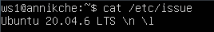
--- -->
### 1.1 Сети и маски

1) Адрес сети **192.167.38.54/13** 
    >Используем команду `ipcalc 192.167.38.54/13`

    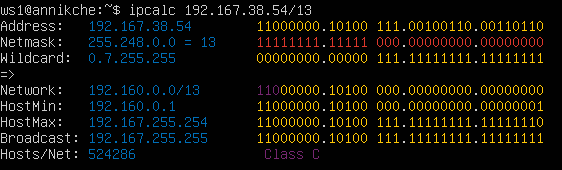

    >**Network: 192.160.0.0** (Адрес сети)

2) Перевод маски:
    - **255.255.255.0** в **префиксную** и **двоичную** запись
        >Используем команду `ipcalc 255.255.255.0`

        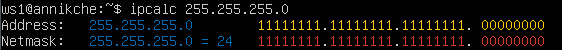
        > перфиксная `24`
        
        > двоичная `11111111.11111111.11111111 00000000`
        
        
    - **/15** в **обычную** и **двоичную**
        >Используем команду `ipcalc /15`

        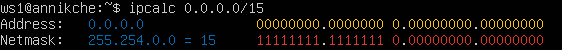
        > обычная `255.254.0.0`
        
        > двоичная `11111111.1111111 0.00000000.00000000`
    - **11111111.11111111.11111111.11110000** в **обычную** и **префиксную**
        >Используем команду `ipcalc /28`

        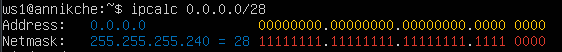
        > обычная `255.255.255.240`
        
        > префиксная `28`

3)  Минимальный и максимальный хост в сети **12.167.38.4** при масках: 
    - /8
        >Используем команду `ipcalc 12.167.38.4/8 | grep -e HostMin -e HostMax`

        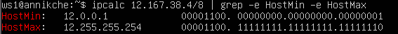
        > минимальный `12.0.0.1`
            
        > максимальный `12.255.255.254`
    - 11111111.11111111.00000000.00000000
        >Используем команду `ipcalc 12.167.38.4/16 | grep -e HostMin -e HostMax`

        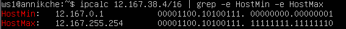
        > минимальный `12.167.0.1`
            
        > максимальный `12.167.255.254`
    - 255.255.254.0
        >Используем команду `ipcalc 12.167.38.4/23 | grep -e HostMin -e HostMax`

        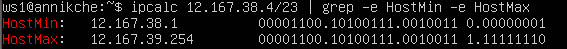
        > минимальный `12.167.38.1`
            
        > максимальный `12.167.39.254`
    - /4
        >Используем команду `ipcalc 12.167.38.4/4 | grep -e HostMin -e HostMax`

        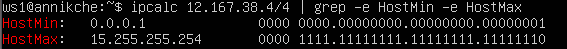
        > минимальный `0.0.0.1`
            
        > максимальный `15.255.255.254`

### 1.2. localhost

1) Определи и запиши в отчёт, можно ли обратиться к приложению, работающему на localhost, со следующими IP: 
    - 194.34.23.100 - `нет`
    - 127.0.0.2 - `да`
    - 127.1.0.1 - `да`
    - 128.0.0.1 - `нет`

### 1.3. Диапазоны и сегменты сетей

1)  Какие из перечисленных IP можно использовать в качестве публичного, а какие только в качестве частных: 10.0.0.45, 134.43.0.2, 192.168.4.2, 172.20.250.4, 172.0.2.1, 192.172.0.1, 172.68.0.2, 172.16.255.255, 10.10.10.10, 192.169.168.1

    >|**Публичные**|**Частные**|
    >|:-:|:-:|
    >|134.43.0.2|10.0.0.45|
    >|172.0.2.1|192.168.4.2|
    >|192.172.0.1|172.20.250.4|
    >|172.68.0.2|172.16.255.255|
    >|192.169.168.1|10.10.10.10|

    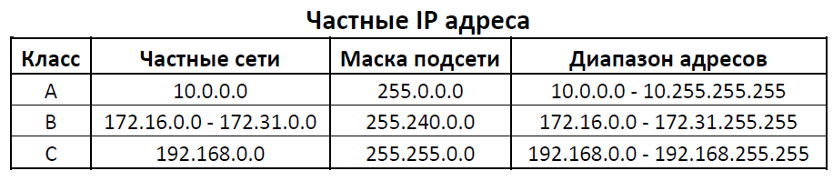

2) Какие из перечисленных IP-адресов шлюза возможны у сети 10.10.0.0/18: 10.0.0.1, 10.10.0.2, 10.10.10.10, 10.10.100.1, 10.10.1.255
    - 10.10.0.2
    - 10.10.10.10
    - 10.10.1.255

## Part 2. Статическая маршрутизация между двумя машинами

С помощью команды ip a посмотри существующие сетевые интерфейсы.
- В отчёт помести скрин с вызовом и выводом использованной команды.
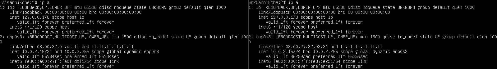

Опиши сетевой интерфейс, соответствующий внутренней сети, на обеих машинах и задай следующие адреса и маски: ws1 — 192.168.100.10, маска /16, ws2 — 172.24.116.8, маска /12.

- ws1

    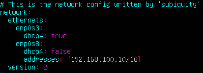

- ws2

    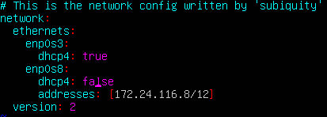

Выполни команду `netplan apply` для перезапуска сервиса сети.

- ws1

    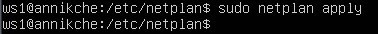

- ws2

    

### 2.1. Добавление статического маршрута вручную

Добавь статический маршрут от одной машины до другой и обратно при помощи команды вида ip r add.

- Добавляем маршрут от ws1 до ws2 командой `sudo ip r add 172.24.116.8 dev enp0s8`

    

- Добавляем маршрут от ws2 до ws1 командой `sudo ip r add 192.168.100.10 dev enp0s8`

    

Пропингуй соединение между машинами.

- Пингуем ws1 c ws2 командой `ping 172.24.116.8`

    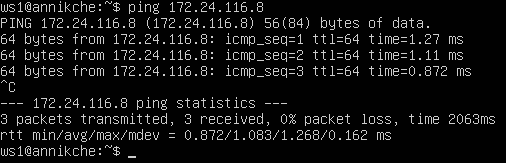

- Пингуем ws2 c ws1 командой `ping 192.168.100.10`

    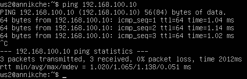

### 2.2. Добавление статического маршрута с сохранением

Перезапусти машины.

Добавь статический маршрут от одной машины до другой с помощью файла `/etc/netplan/00-installer-config.yaml`

- ws1

    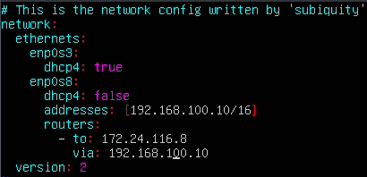

- ws2

    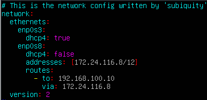

Выполняем команду `sudo netplan apply` для перезапуска сервиса сети на ws1 и ws2

Пропингуй соединение между машинами.

- Пингуем ws1 c ws2 командой `ping 172.24.116.8`

    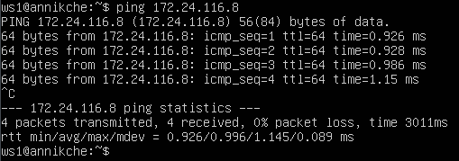

- Пингуем ws2 c ws1 командой `ping 192.168.100.10`

    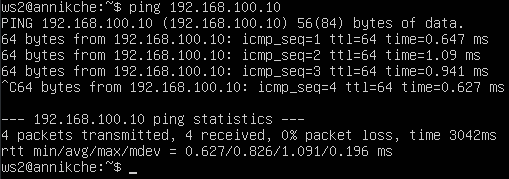

## Part 3. Утилита iperf3

### 3.1. Скорость соединения

Переведи и запиши в отчёт: 
 - 8 Mbps в MB/s
    >1 Мбит = 0,125 Мбайт (поскольку 1 байт = 8 бит)
    >
    >8 Мбит/с * 0,125 Мбайт/Мбит = 1 Мбайт/с
    >
    >Ответ: 1 MB/s
 - 100 MB/s в Kbps
    >1 Мбайт = 8 Мбит
    >
    >1 Мбит = 1000 Кбит
    >
    >100 Мбайт/с * 8 Мбит/Мбайт * 1000 Кбит/Мбит = 800000 Кбит/с
    >
    >Ответ: 800000 Kbps
 - 1 Gbps в Mbps.
    >1 Гбит = 1000 Мбит
    >
    >1 Гбит/с = 1000 Мбит/с
    >
    >Ответ: 1000 Mbps

### 3.2. Утилита iperf3

Измерь скорость соединения между ws1 и ws2.
В отчёт помести скрины с вызовом и выводом использованных команд.

- ws1 используем команду `iperf3 -s (сервер)`

    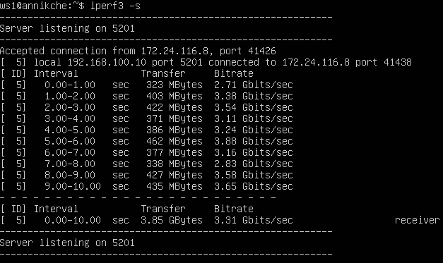

- ws2 используем команду `iperf3 -c 193.168.100.10 (клиент)`

    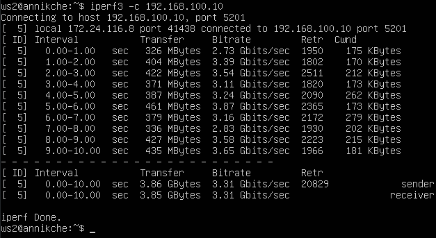

## Part 4. Сетевой экран

Создай файл /etc/firewall.sh, имитирующий файрвол, на ws1 и ws2:

- ws1 используем команду `sudo touch /etc/firewall.sh`

    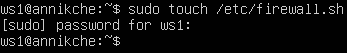

- ws2 используем команду `sudo touch /etc/firewall.sh`

    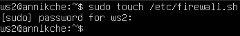

Нужно добавить в файл подряд следующие правила:

1) На ws1 примени стратегию, когда в начале пишется запрещающее правило, а в конце пишется разрешающее правило (это касается пунктов 4 и 5).

2) На ws2 примени стратегию, когда в начале пишется разрешающее правило, а в конце пишется запрещающее правило (это касается пунктов 4 и 5).

3) Открой на машинах доступ для порта 22 (ssh) и порта 80 (http).

4) Запрети echo reply (машина не должна «пинговаться», т. е. должна быть блокировка на OUTPUT).

5) Разреши echo reply (машина должна «пинговаться»).

В отчёт помести скрины с содержанием файла /etc/firewall для каждой машины.

- ws1

    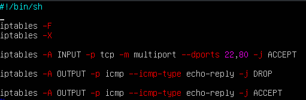

- ws2

    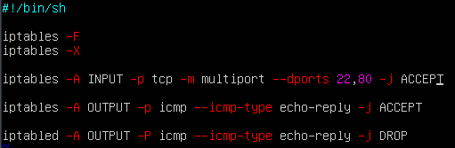

Запусти файлы на обеих машинах командами `chmod +x /etc/firewall.sh` и `/etc/firewall.sh`

В отчёт помести скрины с запуском обоих файлов.

- ws1

    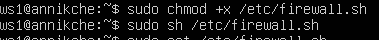

- ws2

    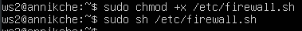
    
В отчёте опиши разницу между стратегиями, применёнными в первом и втором файлах.
- Разница в том чтобы одна машина пинговалась, а вторая нет
    - Пингуем ws1 c ws2 командой `ping 172.24.116.8` 
        
        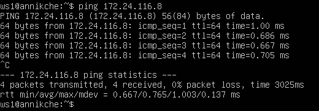

    - Пингуем ws2 c ws1 командой `ping 192.168.100.10`
        
        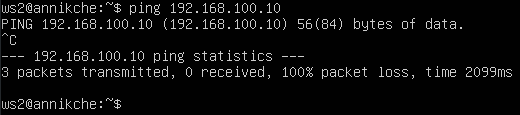

### 4.2. Утилита nmap

Командой ping найди машину, которая не «пингуется», после чего утилитой nmap покажи, что хост машины запущен.
Проверка: в выводе nmap должно быть сказано: Host is up.

В отчёт помести скрины с вызовом и выводом использованных команд ping и nmap.

- ws2

    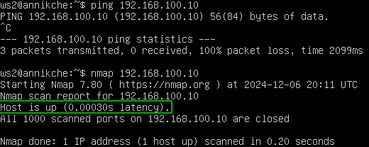

Сохрани дампы образов виртуальных машин

## Part 5. Статическая маршрутизация сети

### 5.1. Настройка адресов машин

Настрой конфигурации машин в etc/netplan/00-installer-config.yaml согласно сети на рисунке.

В отчёт помести скрины с содержанием файла etc/netplan/00-installer-config.yaml для каждой машины.

- ws11 
        
    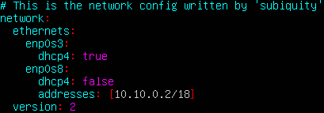

- ws21
        
    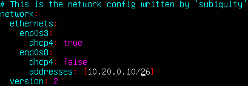

- ws22
        
    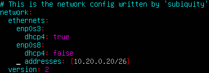

- r1
        
    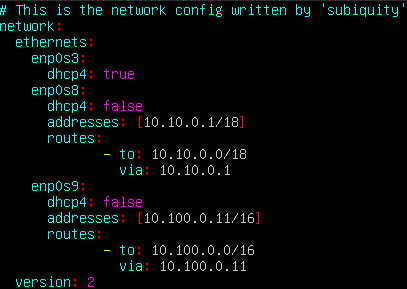

- r2
        
    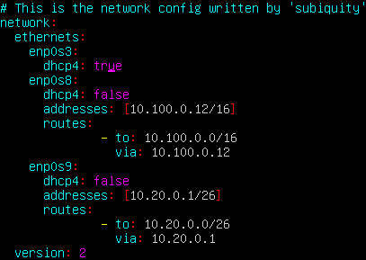

Перезапусти сервис сети. Если ошибок нет, командой `ip -4` a проверь, что адрес машины задан верно.

- ws11 
        
    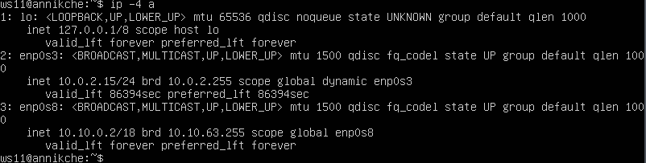

- ws21
        
    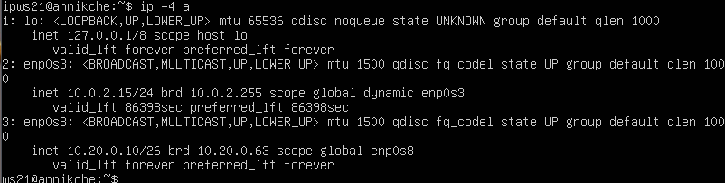

- ws22
        
    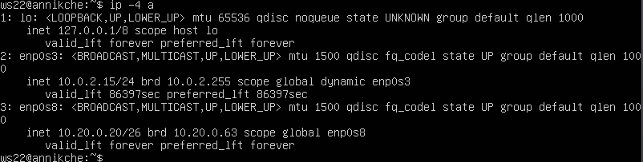

- r1
        
    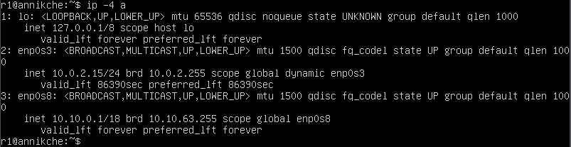

- r2
        
    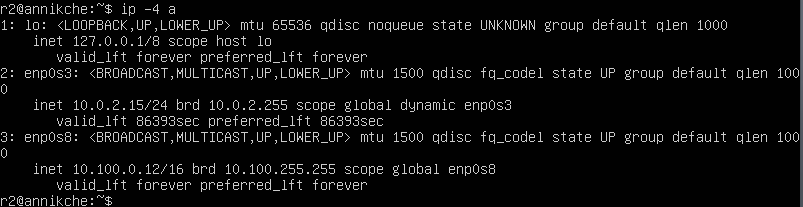

Также пропингуй ws22 с ws21. Аналогично пропингуй r1 с ws11.

- Пингуем ws22 с ws21
        
    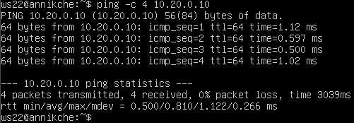

- Пингуем r1 с ws11
        
    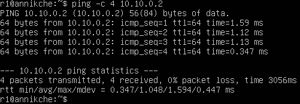

### 5.2. Включение переадресации IP-адресов

Для включения переадресации IP выполни команду на роутерах:
`sysctl -w net.ipv4.ip_forward=1`

- r1
        
    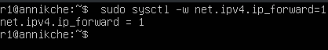

- r2
        
    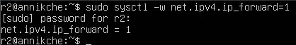

При таком подходе переадресация не будет работать после перезагрузки системы.

Открой файл `/etc/sysctl.conf` и добавь в него следующую строку:
`net.ipv4.ip_forward = 1`
При использовании этого подхода, IP-переадресация включена на постоянной основе.

- r1
        
    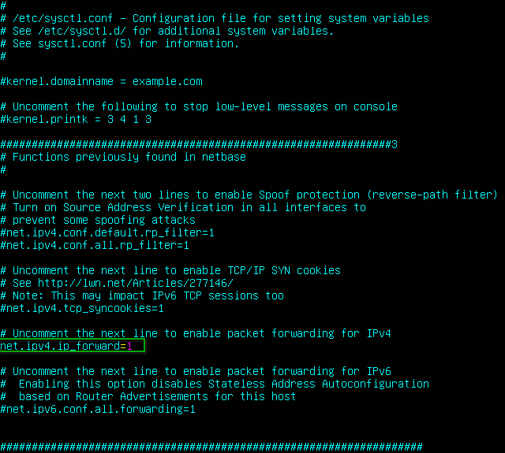

- r2
        
    

### 5.3. Установка маршрута по умолчанию

Настрой маршрут по умолчанию (шлюз) для рабочих станций. Для этого добавь `default` перед IP-роутера в файле конфигураций.

В отчёт помести скрин с содержанием файла `etc/netplan/00-installer-config.yaml`

- ws11 
        
    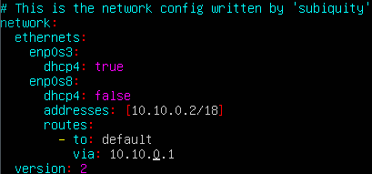

- ws21
        
    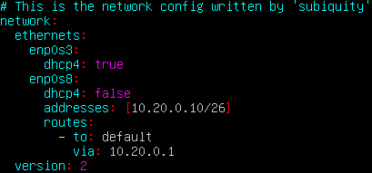

- ws22
        
    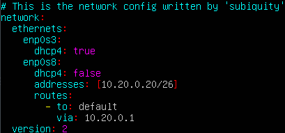

Вызови `ip r` и покажи, что добавился маршрут в таблицу маршрутизации.

- ws11 
        
    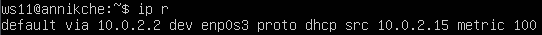

- ws21
        
    

- ws22
        
    

Пропингуй с ws11 роутер r2 и покажи на r2, что пинг доходит. Для этого используй команду:
`tcpdump -tn -i eth0`

- r2
        
    

### 5.4. Добавление статических маршрутов

Добавь в роутеры r1 и r2 статические маршруты в файле конфигураций. Пример для r1 маршрута в сетку 10.20.0.0/26:

- r1 
        
    

- r2
        
    

Вызови `ip r` и покажи таблицы с маршрутами на обоих роутерах. Пример таблицы на r1:

- r1 
        
    

- r2
        
    

Запусти команды на ws11:
`ip r list 10.10.0.0/[маска сети]` и `ip r list 0.0.0.0/0`

В отчёт помести скрин с вызовом и выводом использованных команд;

- ws11
        
    

В отчёте объясни, почему для адреса 10.10.0.0/[маска сети] был выбран маршрут, отличный от 0.0.0.0/0, хотя он попадает под маршрут по умолчанию.

- Вариант использования IP-адреса 0.0.0.0/0 в качестве статического маршрута по умолчанию означает, что в таблице маршрутизации не указан конкретный адрес в качестве следующего перехода на пути пакета к его конечному получателю. Когда маршрут по умолчанию используется с маской подсети 0.0.0.0, он соответствует любому адресу.

### 5.5. Построение списка маршрутизаторов

Запусти на r1 команду дампа:
tcpdump -tnv -i eth0

- Пингуем ws11 и ws21
        
    

- Запусти на r1 команду дампа:
`tcpdump -tnv -i eth0`

    

При помощи утилиты traceroute строим список маршрутизаторов на пути от ws11 до ws21 командой `sudo traceroute 10.20.0.10`

- тут

    

- Команда traceroute linux использует UDP пакеты. Она отправляет пакет с TTL=1 и смотрит адрес ответившего узла, дальше TTL=2, TTL=3 и так пока не достигнет цели. Каждый раз отправляется по три пакета и для каждого из них измеряется время прохождения. Когда утилита traceroute получает сообщение от целевого узла о том, что порт недоступен трассировка считается завершенной.

### 5.6. Использование протокола ICMP при маршрутизации

Пропингуй с ws11 несуществующий IP (например, 10.30.0.111) с помощью команды:
`ping -c 1 10.30.0.111`

- ws11

    

- r1

    

## Part 6. Динамическая настройка IP с помощью DHCP

Для r2 настрой в файле `/etc/dhcp/dhcpd.conf` конфигурацию службы DHCP:

1) Укажи адрес маршрутизатора по умолчанию, DNS-сервер и адрес внутренней сети

    - r2

        

2) В файле `resolv.conf` пропиши `nameserver 8.8.8.8`.

    - r2

        

Перезагрузи службу DHCP командой `systemctl restart isc-dhcp-server`. 

- r2

    

Машину ws21 перезагрузи при помощи reboot и через ip a покажи, что она получила адрес. 

- ws21

    

Также пропингуй ws22 с ws21.

- Пингуем

    

Укажи MAC-адрес у ws11, для этого в `etc/netplan/00-installer-config.yaml` надо добавить строки: `macaddress: 10:10:10:10:10:BA, dhcp4: true`.

- ws11

    

Для r1 настрой аналогично r2, но сделай выдачу адресов с жесткой привязкой к MAC-адресу (ws11). Проведи аналогичные тесты.

1) Укажи адрес маршрутизатора по умолчанию, DNS-сервер и адрес внутренней сети

    - r1

        

2) В файле `resolv.conf` пропиши `nameserver 8.8.8.8`.

    - r1

        

Перезагрузи службу DHCP командой `systemctl restart isc-dhcp-server`. 

- r1

    

Машину ws11 перезагрузи при помощи reboot и через ip a покажи, что она получила адрес. 

- ws21

    

Также пропингуем ws11 с ws22 и ws21.

- Пингуем

    

Запроси с ws21 обновление IP-адреса.

В отчёте помести скрины IP до и после обновления.
В отчёте опиши, какими опциями DHCP сервера пользовался в данном пункте.

- ws21 до обновления

    

- ws21 после обновления

    

## Part 7. NAT

В файле `/etc/apache2/ports.conf` на ws22 и r1 измени строку `Listen 80` на `Listen 0.0.0.0:80`, то есть сделай сервер Apache2 общедоступным.

В отчёт помести скрин с содержанием изменённого файла.

- ws22

    

- r1 

    

Запусти веб-сервер Apache командой `service apache2 start` на ws22 и r1.

В отчёт помести скрины с вызовом и выводом использованной команды.

- ws22

    

- r1 

    

Добавь в фаервол, созданный по аналогии с фаерволом из Части 4, на r2 следующие правила:

1) Удаление правил в таблице filter — `iptables -F`;

2) Удаление правил в таблице «NAT» — `iptables -F -t nat`;

3) Отбрасывать все маршрутизируемые пакеты — `iptables --policy FORWARD DROP`.

- r2 

    

Запусти файл также, как в Части 4.

Проверь соединение между ws22 и r1 командой ping.
При запуске файла с этими правилами, ws22 не должна «пинговаться» с r1.

- ws22

    

Добавь в файл ещё одно правило:

4) Разрешить маршрутизацию всех пакетов протокола ICMP.

- r2 

    

Запусти файл также, как в Части 4.

Проверь соединение между ws22 и r1 командой ping.
При запуске файла с этими правилами, ws22 должна «пинговаться» с r1.

- ws22

    

Добавь в файл ещё два правила:

5) Включи SNAT, а именно маскирование всех локальных IPиз локальной сети, находящейся за r2 (по обозначениям из Части 5 — сеть 10.20.0.0).

6) Включи DNAT на 8080 порт машины r2 и добавить к веб-серверу Apache, запущенному на ws22, доступ извне сети.

 

 Делаем файл исполняемым и запускаем командами `sudo chmod +x /etc/firewall.sh` и `sudo bash /etc/firewall.sh`

Проверь соединение по TCP для SNAT: для этого с ws22 подключиться к серверу Apache на r1 командой:
telnet [адрес] [порт]

 

 Проверь соединение по TCP для DNAT: для этого с r1 подключиться к серверу Apache на ws22 командой `telnet (обращаться по адресу r2 и порту 8080)`.

## Part 8. Дополнительно. Знакомство с SSH Tunnels

Запусти на r2 фаервол с правилами из Части 7.

Запусти веб-сервер Apache на ws22 только на `localhost` (то есть в файле `/etc/apache2/ports.conf` измени строку `Listen 80` на `Listen localhost:80`).

Устанавливаем утилиту SSH на ws11, ws21, ws22 командой `sudo apt install openssh-server` и включаем его командой `sudo sysremctl enable ssh`

Воспользуйся Local TCP forwarding с ws21 до ws22, чтобы получить доступ к веб-серверу на ws22 с ws21.

Для проверки, сработало ли подключение в обоих предыдущих пунктах, перейди во второй терминал (например, клавишами Alt + F2) и выполни команду:
telnet 127.0.0.1 [локальный порт]

Воспользуйся Remote TCP forwarding c ws11 до ws22, чтобы получить доступ к веб-серверу на ws22 с ws11.

Для проверки, сработало ли подключение в обоих предыдущих пунктах, перейди во второй терминал (например, клавишами Alt + F2) и выполни команду:
telnet 127.0.0.1 [локальный порт]

